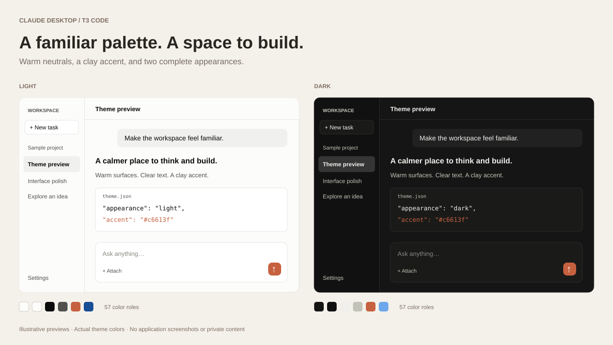

# Claude Desktop for T3 Code

[简体中文](README.zh-CN.md)

A Claude Desktop–inspired color theme for [T3 Code](https://github.com/pingdotgg/t3code): warm off-white surfaces, charcoal dark mode, and a clay accent. Both appearances are included in one native T3 theme file.

*Illustrative layouts using the theme's actual colors, not screenshots of the application.*

## Install

1. [Download claude-desktop.json](https://github.com/markshan00/t3code-claude-theme/releases/latest/download/claude-desktop.json).
2. In T3 Code, open **Settings → Appearance → Import theme**. In some versions, the theme library is labeled **Colors & themes**.
3. Choose the downloaded JSON file, or paste its contents into the theme importer, and confirm.
4. Select **Claude Desktop**. Select its light and dark previews for the respective appearances; choose **System** if you want to follow your system appearance.

You can also [view and copy the raw JSON](https://raw.githubusercontent.com/markshan00/t3code-claude-theme/main/claude-desktop.json). No extension, build, or command-line installer is needed. See T3's [appearance guide](https://github.com/pingdotgg/t3code/blob/main/docs/user/appearance.md) for theme controls.

## Palette

| Role | Light | Dark |
| --- | --- | --- |
| Canvas | `#fcfcfb` | `#151515` |
| Sidebar | `#fcfcfb` | `#111111` |
| Main text | `#0b0b0b` | `#f0efec` |
| Secondary text | `#52514e` | `#c3c2b7` |
| Accent | `#c6613f` | `#c6613f` |

Each appearance defines 57 color roles, covering the conversation, sidebar, toolbar, code blocks, terminal, and status colors. This is a color theme; it does not install Claude's fonts or change T3's layout.

The theme uses T3's version 1 JSON format and the stable ID `claude-desktop`. If you already have a theme with that ID, export your edited copy before choosing to replace it.

## Origin and compatibility

Originally adapted on October 4, 2026 from Claude Desktop's cached design-token and desktop-frame styles. The published colors match the maintainer's installed **Claude 桌面** theme; only the display name has been changed to **Claude Desktop** for sharing. See [provenance and validation](docs/provenance.md).

Maintained by [Mark](https://github.com/markshan00). This is an unofficial community theme, not affiliated with or endorsed by Anthropic or T3 Tools. Claude and T3 Code names belong to their respective owners.

[MIT license](LICENSE) for this adaptation, documentation, and preview artwork. Original third-party product assets are not included.
